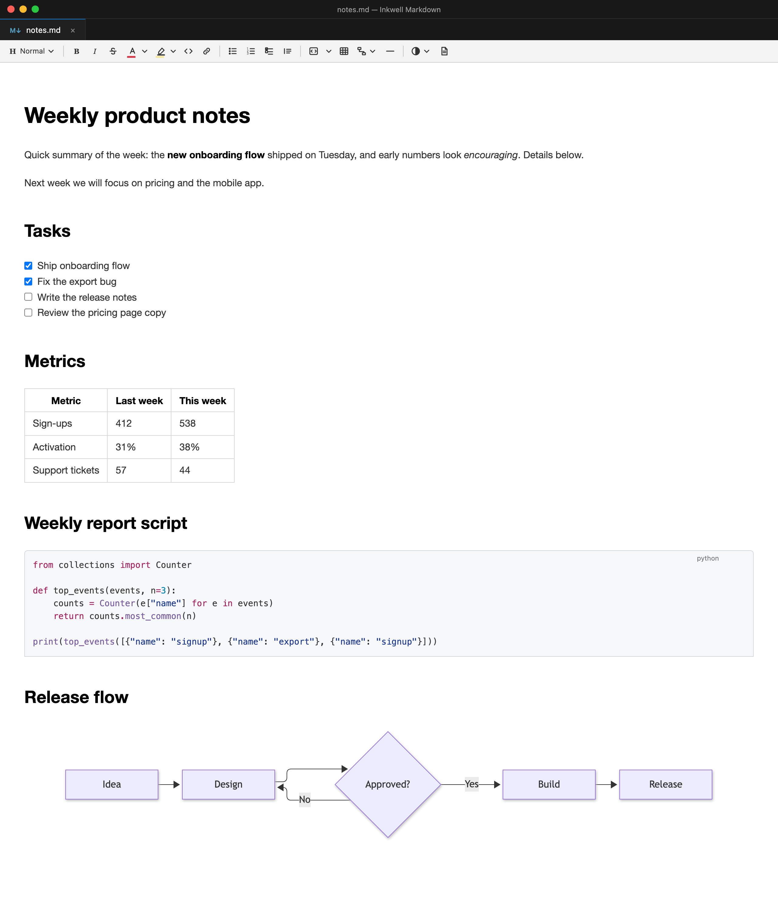
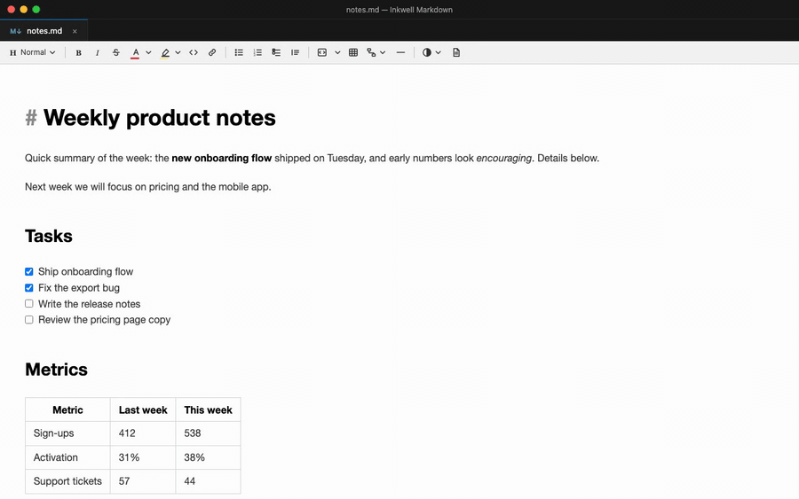
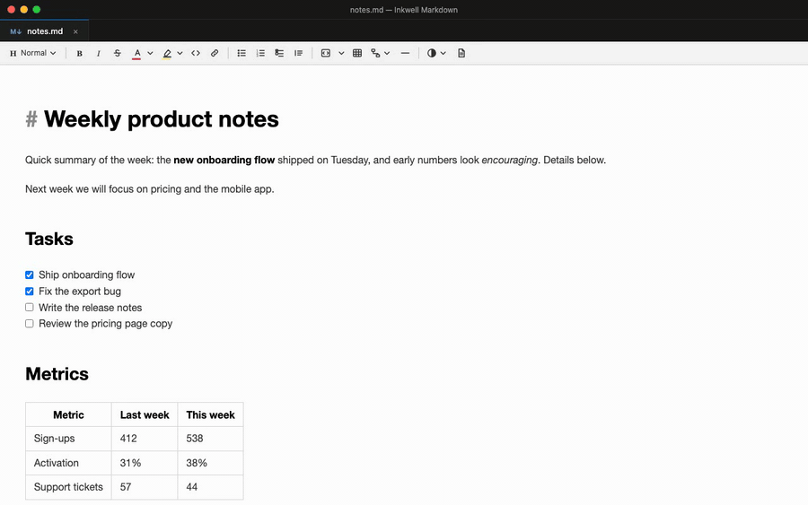
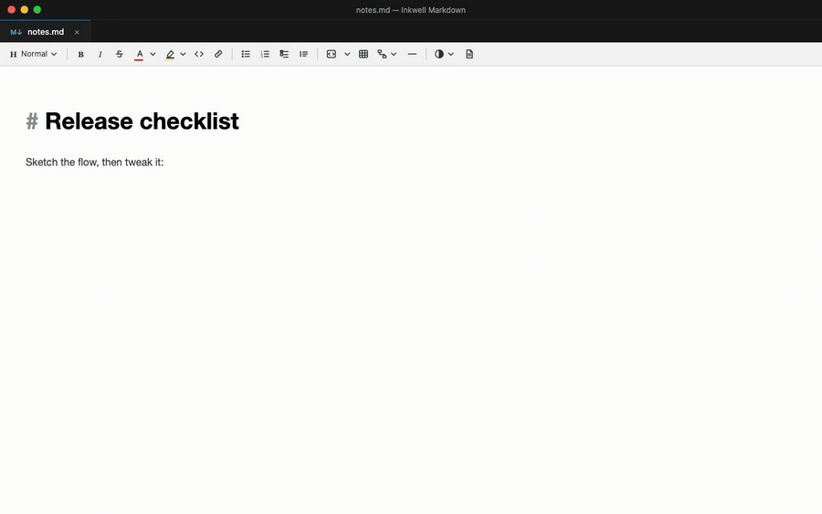
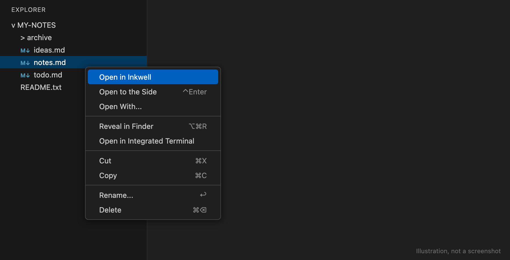

<p align="center"></p>

# Inkwell Markdown

**Edit Markdown directly on the rendered page.** Headings, tables, checklists, code and diagrams look finished while you type, and the raw Markdown appears only on the line you are editing.



Designed by [sajjadmz](https://github.com/sajjadmz) · Built with [Claude](https://claude.com/claude-code)

## Features

- **Live preview, Obsidian style.** Text is shown styled. Move the cursor into a heading, bold word or link and the Markdown symbols appear; move away and they hide again.
- **A familiar toolbar and Word-style shortcuts.** Bold, italic, lists, headings, links, code blocks and more, with the shortcuts you already know.
- **Editable tables.** Click a cell and type. A small bar adds, deletes and aligns rows and columns.
- **Text colour and highlighter.** Six colours that read well in light and dark themes. Stored as small HTML tags that GitHub and Markdown Preview Enhanced also display.
- **Mermaid diagrams.** Insert a starter flowchart, sequence, timeline, mind map, Gantt, pie or state diagram from the Diagram menu. The diagram redraws as you type.
- **Syntax-coloured code blocks** for about 100 languages, and **clickable checkboxes** in task lists.
- **18 page styles** from Markdown Preview Enhanced (GitHub, One, Atom, Solarized, Monokai and more), following your VS Code theme by default.
- **Safe by design.** It edits your file's text directly. See [Your file is safe](#your-file-is-safe).

### Live preview



### Toolbar



### Tables


### Diagrams



### Dark theme


## Install

### In VS Code (no coding needed)

1. Open VS Code.
2. In the left sidebar, click the **Extensions** icon (four small squares, one slightly apart). Or use the menu bar: **View** → **Extensions**.
3. In the search box at the top of that panel, type **Inkwell Markdown**.
4. Click **Inkwell Markdown** by *sajjadmotamed*, then click the blue **Install** button.
5. That's it. Open any `.md` file and it appears in Inkwell (see [How to open a file](#how-to-open-a-file)).

Or install from the [VS Code Marketplace page](https://marketplace.visualstudio.com/items?itemName=sajjadmotamed.inkwell-markdown) by clicking **Install**.

### Cursor, VSCodium and Windsurf

These editors get extensions from [Open VSX](https://open-vsx.org/extension/sajjadmotamed/inkwell-markdown). The steps are the same as above: open the **Extensions** panel, search for **Inkwell Markdown**, click **Install**.

### From a terminal (for coders)

```
code --install-extension sajjadmotamed.inkwell-markdown
```

For Cursor use `cursor --install-extension sajjadmotamed.inkwell-markdown`.

### Build from source

You need Node.js 20 or later.

```
git clone https://github.com/sajjadmz/inkwell-markdown.git
cd inkwell-markdown
npm ci
npm run package
code --install-extension inkwell-markdown-<version>.vsix
```

`<version>` is the number in `package.json` (for example `0.4.0`). To run the tests (they download a copy of VS Code once):

```
npm test
```

## How to open a file

**You don't need to do anything special.** Once Inkwell is installed, it is already the default for Markdown files (files ending in `.md`). Just open one the way you normally would:

1. In VS Code's left sidebar (the **Explorer**, the icon that looks like two sheets of paper), find your Markdown file.
2. **Click it once.** It opens in Inkwell, looking like a formatted document with the toolbar at the top.

**If a file opens as plain text instead** (for example, the `#` and `**` symbols show everywhere):

- **Right-click** the file in the left sidebar and choose **Open in Inkwell**, or
- **Right-click the file's tab** at the top of the editor and choose **Open in Inkwell**.



*Illustration (a mock-up, not a screenshot).*

**To see the raw Markdown text again,** click the **page icon at the far right of Inkwell's toolbar** (its tooltip says *Open as plain text*). To come back, right-click the tab and choose **Open in Inkwell**.

> **Keyboard users:** Cmd+Shift+V (Mac) or Ctrl+Shift+V (Windows and Linux) switches between Inkwell and plain text. This replaces VS Code's built-in Markdown preview shortcut; that preview is still available from the Command Palette (see below).

### What is the "Command Palette"?

Some steps below use the **Command Palette**. It is VS Code's search box for actions: you type what you want to do, then pick it from a list. To open it:

1. Go to the **menu bar** and click **View**. On a Mac the menu bar is at the very top of your screen; on Windows and Linux it is at the top of the VS Code window.
2. Click **Command Palette...**. A search box appears at the top-centre of VS Code.
3. Type the name of the action (for example `Inkwell`). Matching actions appear as you type.
4. **Click** the one you want (or press **Enter**).

Keyboard shortcut for the same box: Cmd+Shift+P (Mac) or Ctrl+Shift+P (Windows and Linux).

## Make it (or stop it being) your default Markdown editor

Inkwell is the default straight after installing, so most people never need this section. Use it if you want Markdown files to open as plain text by default, or to switch back.

**The simple way**

1. Open the **Command Palette** (menu bar: **View** → **Command Palette...**).
2. Type `Inkwell default`.
3. Click **Inkwell: Toggle open by default**.
4. A small message appears in the bottom-right corner:
   - **ON** means Markdown files open in Inkwell.
   - **OFF** means they open as plain text.
5. Do the same again whenever you want to switch back.

**VS Code's own way** (works for any file type)

1. Open any Markdown file.
2. Open the **Command Palette** (menu bar: **View** → **Command Palette...**).
3. Type `Reopen Editor With` and click **View: Reopen Editor With...**.
4. In the list that appears, click **Configure default editor for '*.md'...**.
5. Click **Inkwell** to make it the default, or **Text Editor** for plain text.


*Illustration (a mock-up, not a screenshot). The exact wording can differ slightly between VS Code versions.*

<details>
<summary>For advanced users: what the toggle changes</summary>

The setting `inkwell.openByDefault` shows the current state; change it with the command rather than by hand. Switching OFF adds `*.md` and `*.markdown` entries to `workbench.editorAssociations`; switching ON removes the entries it added.
</details>

## Toolbar

From left to right:

| Button | What it does |
|---|---|
| Heading menu | Heading 1, 2, 3 or normal text |
| **B**, *I*, ~~S~~ | Bold, italic, strikethrough |
| Text colour | Colour the selected text. The arrow opens six colours and "No colour". |
| Highlighter | Highlight the selected text. The arrow opens six colours. |
| Inline code, Link | `code` formatting and a link |
| Bullets, Numbers, Checklist, Quote | Lists and block quotes |
| Decrease indent, Increase indent | Move a list item out of, or into, the item above it (lists only) |
| Code block | Fenced code block. The arrow picks the language. |
| Table | Insert a 3 × 2 table |
| Diagram ▾ | Insert a starter Mermaid diagram: flowchart, sequence, timeline, mind map, Gantt, pie or state |
| Horizontal rule | A divider line |
| Page style | Choose the look of the page |
| Open as plain text | Switch this file to VS Code's text editor |

Pressing a formatting button or shortcut a second time removes that formatting, as in Word.

## Shortcuts

These work only inside the Inkwell editor (except the first row). Save, undo and redo are VS Code's own.

| Action | Mac | Windows / Linux |
|---|---|---|
| Switch Inkwell / plain text | Cmd+Shift+V | Ctrl+Shift+V |
| Bold | Cmd+B | Ctrl+B |
| Italic | Cmd+I | Ctrl+I |
| Strikethrough | Cmd+Shift+X | Ctrl+Shift+X |
| Link | Cmd+K | Ctrl+K |
| Inline code | Cmd+E | Ctrl+E |
| Bulleted list | Cmd+Shift+8 | Ctrl+Shift+8 |
| Numbered list | Cmd+Shift+7 | Ctrl+Shift+7 |
| Checklist | Cmd+Shift+9 | Ctrl+Shift+9 |
| Quote | Cmd+Shift+. | Ctrl+Shift+. |
| Increase indent (list items) | Cmd+] or Tab | Ctrl+] or Tab |
| Decrease indent (list items) | Cmd+[ or Shift+Tab | Ctrl+[ or Shift+Tab |
| Heading 1 / 2 / 3 | Cmd+Alt+1 / 2 / 3 | Ctrl+Shift+Alt+1 / 2 / 3 |
| Normal text | Cmd+Alt+0 | Ctrl+Shift+Alt+0 |
| Code block | Cmd+Alt+C | Ctrl+Shift+Alt+C |
| Highlight (last colour used) | Cmd+Shift+H | Ctrl+Shift+H |
| Text colour (last colour used) | Cmd+Shift+C | Ctrl+Shift+C |
| Find | Cmd+F | Ctrl+F |
| Find and replace | Cmd+Alt+F | Ctrl+H |
| Next match | Cmd+G | F3 |
| Previous match | Cmd+Shift+G | Shift+F3 |

**Why Ctrl+Shift+Alt on Windows and Linux?** On many European keyboard layouts, Ctrl+Alt is the same as AltGr, which types characters such as `@`, `{` and `[`. Using Ctrl+Alt for headings would block those characters, so these shortcuts add Shift.

## Typing helpers

### Double space gives a full stop
Like on a Mac: type a space after a word, then another, and the two spaces become a full stop and a space. It works in normal text, headings, lists, quotes and table cells. It never happens after punctuation, at the start of a line, or inside code, links and the front-matter block at the top of a file. One Undo (Cmd/Ctrl+Z) gives the two spaces back. (In a table cell, Undo takes the full stop away, because tables do not keep spaces at the end of a cell.)
It also works right after a closing `~~`, colour tag (`</span>`, `</mark>`) or `</b>`, `</i>`, `</u>`, `</s>`, `</del>`, `</strong>`, `</em>`. If the cursor is just before closing marks (`**bold|**`), the full stop goes inside them and the space after them (`**bold.** `), so bold, italic and the like are never broken; one Undo still gives back the two spaces.
Setting: **Inkwell: Double Space Period**. "auto" (the default) is on for Mac and off for Windows and Linux; choose "on" or "off" to force it.

### Indent and outdent lists
Put the cursor on a bullet, numbered or checklist item (or select several) and press the Increase indent button, Cmd/Ctrl+] or Tab. The item moves in under the item above it. Decrease indent, Cmd/Ctrl+[ or Shift+Tab moves it back out. Only the spaces in front of the item change, never your words.
- With several items selected (or Select All) they move as one block: an item whose parent is selected too moves with it and keeps its place inside it. An item that cannot move (the first one, with nothing above it to sit under) stays where it is and the others still move; you only get a note when nothing at all could change. Decrease indent works the same way. It is one Undo step.
- **Numbers restart when they start a new level, like in Word.** A numbered item that becomes the first item of a nested list is renumbered to `1.` (Markdown does not allow a nested list to start at another number); one that joins a nested list that is already there gets the previous number plus one; one that moves back out gets the previous number at that level plus one. Only the numbers of the items you moved change, nothing else in the list.
- On normal text, headings and quotes, Tab and Shift+Tab show a note ("Indent works on bullet and numbered lists"), type nothing and keep the cursor in the editor. (Press Esc first if you want Tab to move on to the next control; inside a code block Tab is unchanged.) Inside a table cell Tab still jumps to the next cell.

### Lists work like Word
- **Enter** at the end of a bullet, numbered or checklist item starts the next item (the next number, an empty checkbox). Enter in the middle of an item splits it, Enter in front of the text opens an empty item above. If your list has blank lines between its items, the new item gets one too, so the list keeps its look. Lines in a quote (`>`) continue the quote, and lists inside quotes work the same way.
- **Enter on an empty item** ends the list. If the item is indented, it moves out one level instead (like pressing Shift+Tab).
- **Shift+Enter** starts a new line *inside the same item*, lined up under the item's text. Other Markdown viewers show such a line as a space, as Markdown has no other way to say it without extra characters in your text.
- **Backspace right after the number or bullet** removes it and keeps your words (one Undo brings it back). Backspace again joins the line with the one above, as usual. Markdown has no "unnumbered line inside a list", so the words are set apart with a blank line from the items around them, and an indented item keeps its indentation and becomes a paragraph of the item above. **Delete** at the end of an item pulls the next item's words up and removes its number.
- **Numbers stay in order by themselves.** When you add, remove, move, paste or indent items, or type a number such as `2.` yourself, the numbers after that place are counted on again (`3.`, `4.` ...). Only the digits change. A list that starts at `5.` keeps starting at 5; a list where every item says `1.` stays that way; lists you did not touch are never renumbered, and neither are changes that come from another program. Undo puts back exactly what was there.
- Inside a **table cell**, a line that starts with `- `, `1. ` or `☐ ` continues on Enter, and Enter or Backspace on an empty one removes the prefix.
- After **Increase / Decrease indent** your cursor stays where it was in the text (also when it was in front of the number), and a selection keeps selecting the same words.

### Wrapped list items hang neatly
When a bullet, numbered or checklist item is long and wraps onto more lines, the extra lines line up under the start of the item's text, not under the bullet, at every level, also inside quotes.

### Find and replace
Press Cmd+F (Mac) or Ctrl+F (Windows and Linux). A small bar slides in under the toolbar. Type what you are looking for and every match is highlighted on the page, with a counter such as "3 of 12". The current match is the stronger colour.

- **Next and Previous:** Enter and Shift+Enter in the Find box, the arrow buttons, or Cmd+G and Cmd+Shift+G (Mac) / F3 and Shift+F3 (Windows and Linux). After the last match you go round to the first.
- **Options:** **Aa** matches capital letters exactly; **ab** (underlined) finds whole words only.
- **Close:** press Esc or the X. If you chose a match (typed in the Find box, or used Next, Previous or Enter), that match is selected for you, as in Word. If you only opened the bar and closed it again, your cursor or selection (also inside a table cell) is exactly where you left it, so the next key you type goes there. If you had selected one line of text before pressing Cmd/Ctrl+F, it is already typed into the Find box.
- **Replace:** press Cmd+Alt+F (Mac) / Ctrl+H (Windows and Linux), or click the small arrow at the left of the bar, to show the Replace row. **Replace** changes the current match and moves to the next one. **Replace all** changes every match in one go and says "Replaced 12"; one Undo (Cmd/Ctrl+Z) brings them all back. The replacement is plain text, so a `*` or `|` you type is just that character.

Inkwell searches what you can read on the page, not the Markdown symbols behind it. So "two months" finds **two** months in bold, and the words inside a link or a table cell, but not the web address of a link, the tags of HTML, the front-matter block at the top of a file, or the text of a picture's name. A match never runs across two lines, two paragraphs, two table cells or a line break (`<br>`).

When a match is split by formatting, for example **two** months, the new text goes into the first part and the rest of the old words are removed; the bold stays around the new text. If a replacement would break the formatting or a table, that match is skipped and the bar tells you ("Skipped one match" or "Replaced 11, skipped 1"). Your file is never left half-broken.

(Cmd+Shift+H on a Mac is still the highlighter, so Replace uses Cmd+Alt+F, the same as VS Code's own Replace.)

### Paste or drop pictures
Copy a picture (for example a screenshot) and paste it with Cmd/Ctrl+V, or drop picture files onto the page (**hold Shift while you drop**; without Shift, VS Code opens the file in a new tab instead). Inkwell saves the picture in an `images` folder next to your Markdown file (named like `my-note-20261124-093015.png`; an existing file is never overwritten) and inserts the picture at the cursor, or in the table cell you are in. Pictures can be png, jpg, jpeg, gif, webp or svg, up to 25 MB.
- Save a brand-new file first; otherwise you get the note "Save the file first to paste pictures."
- Undo removes the picture from the page, but the saved file stays in `images`; delete it yourself if you do not want it.
- Pasting text works exactly as before. If a copy contains both text and a picture (as Word does), the text is pasted.
- If VS Code still opens the file in a new tab, you let go of Shift too early: hold Shift from before you start dragging until after you drop. Or just copy the picture and paste it.

## Page styles

Inkwell uses the preview themes of Markdown Preview Enhanced. The default, **Auto**, picks `github-light` or `github-dark` to match your VS Code colour theme. Available styles:

`atom-dark`, `atom-light`, `atom-material`, `github`, `github-dark`, `github-light`, `gothic`, `medium`, `monokai`, `newsprint`, `night`, `none`, `one-dark`, `one-light`, `solarized-dark`, `solarized-light`, `vscode`, `vue`

To choose one, use any of these:

- The **Page style** button in the toolbar.
- The Command Palette: **Inkwell: Choose page style**.
- The setting `inkwell.previewTheme` (for example `one-dark.css`, or `auto`).

## Your file is safe

Inkwell edits your file's text directly. When you type, only the characters you change are sent to VS Code, never a rewritten copy of the whole file, so spacing, line endings and anything Inkwell does not display stay exactly as they were. Opening a file and closing it again does not touch it.

VS Code does the saving and undo, so Save, Undo, Redo, dirty markers and Local History work as in any other editor. If another program changes the very text you just edited (for example it reverts the file), Inkwell starts Undo fresh and says so on the page, so Undo can never put the old edit back into the wrong place; changes made elsewhere in the file leave Undo working. The behaviour is covered by more than 150 automated tests that run on macOS, Windows and Linux on every change.

## Updates

Install from a Marketplace and updates arrive automatically. VS Code installs a new version in the background; it takes effect after you click **Restart Extensions** in the prompt, or on your next launch.

## Limitations

- Tables inside lists or quotes stay as raw Markdown text.
- Find does not match across a line break, even in the middle of a wrapped paragraph that you typed on two lines.
- No maths (LaTeX) rendering.
- Not available in the browser (vscode.dev, github.dev).
- Files larger than 2 MB open in VS Code's plain text editor.

## Credits

- Page styles come from [Markdown Preview Enhanced](https://github.com/shd101wyy/vscode-markdown-preview-enhanced) / [crossnote](https://github.com/shd101wyy/crossnote) by Yiyi Wang (NCSA licence).
- [CodeMirror 6](https://codemirror.net/) powers the editor and [Mermaid](https://mermaid.js.org/) draws the diagrams.
- Full licence texts: [THIRD_PARTY_NOTICES.md](THIRD_PARTY_NOTICES.md).

Contributions are welcome: see [CONTRIBUTING.md](CONTRIBUTING.md). Version history: [CHANGELOG.md](CHANGELOG.md).

## License

[MIT](LICENSE)
