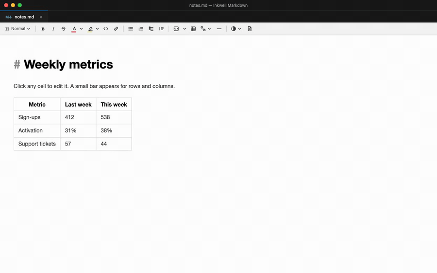
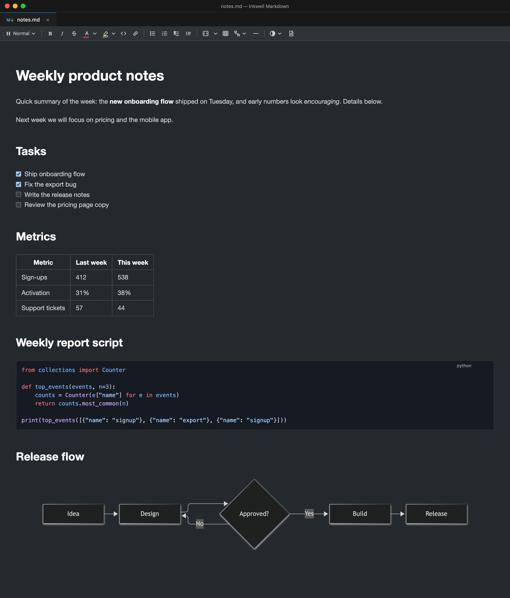

<p align="center"></p>

# Inkwell Markdown

**Edit Markdown directly on the rendered page.** Headings, tables, checklists, code and diagrams look finished while you type, and the raw Markdown appears only on the line you are editing.


Designed by [sajjadmz](https://github.com/sajjadmz) · Built with [Claude](https://claude.com/claude-code)

## Features

- **Live preview, Obsidian style.** Text is shown styled. Move the cursor into a heading, bold word or link and the Markdown symbols appear; move away and they hide again.
- **A familiar toolbar and Word-style shortcuts.** Bold, italic, lists, headings, links, code blocks and more, with the shortcuts you already know.
- **Editable tables.** Click a cell and type. A small bar adds, deletes and aligns rows and columns.
- **Text colour and highlighter.** Six colours that read well in light and dark themes. Stored as small HTML tags that GitHub and Markdown Preview Enhanced also display.
- **Mermaid diagrams.** Insert a starter flowchart, sequence, timeline, mind map, Gantt, pie or state diagram from the Diagram menu. The diagram redraws as you type.
- **Syntax-coloured code blocks** for about 100 languages, and **clickable checkboxes** in task lists.
- **18 page styles** from Markdown Preview Enhanced (GitHub, One, Atom, Solarized, Monokai and more), following your VS Code theme by default.
- **Safe by design.** It edits your file's text directly. See [Your file is safe](#your-file-is-safe).

### Live preview


### Toolbar


### Tables



### Diagrams


### Dark theme



## Install

### From the Marketplace

Open the Extensions view in VS Code, search for **Inkwell Markdown** and click Install. Or from a terminal:

```
code --install-extension sajjadmotamed.inkwell-markdown
```

### Cursor, VSCodium and Windsurf

These editors use [Open VSX](https://open-vsx.org/). Search for **Inkwell Markdown** in their Extensions view, or run the same command with your editor's CLI (for example `cursor --install-extension sajjadmotamed.inkwell-markdown`).

### Build from source

You need Node.js 20 or later.

```
git clone https://github.com/sajjadmz/inkwell-markdown.git
cd inkwell-markdown
npm ci
npm run package
code --install-extension inkwell-markdown-<version>.vsix
```

`<version>` is the number in `package.json` (for example `0.4.0`). To run the tests (they download a copy of VS Code once):

```
npm test
```

## How to open a file

Inkwell opens `.md` and `.markdown` files by default, so after installing you can simply open a Markdown file. You do not need any shortcut:

1. **Right-click a file** in the Explorer and choose **Open in Inkwell**.
2. **Right-click an editor tab** of a Markdown file and choose **Open in Inkwell**.
3. **Command Palette** (View menu, then Command Palette): type **Inkwell: Open**.
4. The **preview button** at the top right of a Markdown editor does the same thing.


*Illustration (a mock-up, not a screenshot).*

To go back to the plain text of the same file, click **Open as plain text** at the right end of the toolbar. The shortcut **Cmd+Shift+V** (Mac) or **Ctrl+Shift+V** (Windows and Linux) switches between Inkwell and plain text in either direction. It replaces VS Code's built-in preview shortcut for `.md` files; that preview is still available from the Command Palette.

## Make it (or stop it being) your default `.md` editor

After installing, Inkwell is the default editor for Markdown files. There are two ways to change that.

**Inside Inkwell**

1. Open the Command Palette and run **Inkwell: Toggle open by default**.
2. A message confirms the new state: ON (Inkwell opens `.md` files) or OFF (VS Code's text editor does).

The setting `inkwell.openByDefault` shows the current state. Use the command to change it, because editing the setting by hand does nothing. Switching OFF adds `*.md` and `*.markdown` entries to `workbench.editorAssociations`; switching ON removes the entries it added.

**With VS Code's own picker**

1. Open a Markdown file.
2. Open the Command Palette and run **View: Reopen Editor With...**
3. Choose **Configure default editor for '*.md'...**, then pick the editor you want.


*Illustration (a mock-up, not a screenshot). The exact wording can differ between VS Code versions.*

## Toolbar

From left to right:

| Button | What it does |
|---|---|
| Heading menu | Heading 1, 2, 3 or normal text |
| **B**, *I*, ~~S~~ | Bold, italic, strikethrough |
| Text colour | Colour the selected text. The arrow opens six colours and "No colour". |
| Highlighter | Highlight the selected text. The arrow opens six colours. |
| Inline code, Link | `code` formatting and a link |
| Bullets, Numbers, Checklist, Quote | Lists and block quotes |
| Code block | Fenced code block. The arrow picks the language. |
| Table | Insert a 3 × 2 table |
| Diagram ▾ | Insert a starter Mermaid diagram: flowchart, sequence, timeline, mind map, Gantt, pie or state |
| Horizontal rule | A divider line |
| Page style | Choose the look of the page |
| Open as plain text | Switch this file to VS Code's text editor |

Pressing a formatting button or shortcut a second time removes that formatting, as in Word.

## Shortcuts

These work only inside the Inkwell editor (except the first row). Save, undo and redo are VS Code's own.

| Action | Mac | Windows / Linux |
|---|---|---|
| Switch Inkwell / plain text | Cmd+Shift+V | Ctrl+Shift+V |
| Bold | Cmd+B | Ctrl+B |
| Italic | Cmd+I | Ctrl+I |
| Strikethrough | Cmd+Shift+X | Ctrl+Shift+X |
| Link | Cmd+K | Ctrl+K |
| Inline code | Cmd+E | Ctrl+E |
| Bulleted list | Cmd+Shift+8 | Ctrl+Shift+8 |
| Numbered list | Cmd+Shift+7 | Ctrl+Shift+7 |
| Checklist | Cmd+Shift+9 | Ctrl+Shift+9 |
| Quote | Cmd+Shift+. | Ctrl+Shift+. |
| Heading 1 / 2 / 3 | Cmd+Alt+1 / 2 / 3 | Ctrl+Shift+Alt+1 / 2 / 3 |
| Normal text | Cmd+Alt+0 | Ctrl+Shift+Alt+0 |
| Code block | Cmd+Alt+C | Ctrl+Shift+Alt+C |
| Highlight (last colour used) | Cmd+Shift+H | Ctrl+Shift+H |
| Text colour (last colour used) | Cmd+Shift+C | Ctrl+Shift+C |

**Why Ctrl+Shift+Alt on Windows and Linux?** On many European keyboard layouts, Ctrl+Alt is the same as AltGr, which types characters such as `@`, `{` and `[`. Using Ctrl+Alt for headings would block those characters, so these shortcuts add Shift.

## Page styles

Inkwell uses the preview themes of Markdown Preview Enhanced. The default, **Auto**, picks `github-light` or `github-dark` to match your VS Code colour theme. Available styles:

`atom-dark`, `atom-light`, `atom-material`, `github`, `github-dark`, `github-light`, `gothic`, `medium`, `monokai`, `newsprint`, `night`, `none`, `one-dark`, `one-light`, `solarized-dark`, `solarized-light`, `vscode`, `vue`

To choose one, use any of these:

- The **Page style** button in the toolbar.
- The Command Palette: **Inkwell: Choose page style**.
- The setting `inkwell.previewTheme` (for example `one-dark.css`, or `auto`).

## Your file is safe

Inkwell edits your file's text directly. When you type, only the characters you change are sent to VS Code, never a rewritten copy of the whole file, so spacing, line endings and anything Inkwell does not display stay exactly as they were. Opening a file and closing it again does not touch it.

VS Code does the saving and undo, so Save, Undo, Redo, dirty markers and Local History work as in any other editor. The behaviour is covered by more than 150 automated tests that run on macOS, Windows and Linux on every change.

## Updates

Install from a Marketplace and updates arrive automatically. VS Code installs a new version in the background; it takes effect after you click **Restart Extensions** in the prompt, or on your next launch.

## Limitations

- Tables inside lists or quotes stay as raw Markdown text.
- No maths (LaTeX) rendering.
- Not available in the browser (vscode.dev, github.dev).
- Files larger than 2 MB open in VS Code's plain text editor.

## Credits

- Page styles come from [Markdown Preview Enhanced](https://github.com/shd101wyy/vscode-markdown-preview-enhanced) / [crossnote](https://github.com/shd101wyy/crossnote) by Yiyi Wang (NCSA licence).
- [CodeMirror 6](https://codemirror.net/) powers the editor and [Mermaid](https://mermaid.js.org/) draws the diagrams.
- Full licence texts: [THIRD_PARTY_NOTICES.md](THIRD_PARTY_NOTICES.md).

Contributions are welcome: see [CONTRIBUTING.md](CONTRIBUTING.md). Version history: [CHANGELOG.md](CHANGELOG.md).

## License

[MIT](LICENSE)
