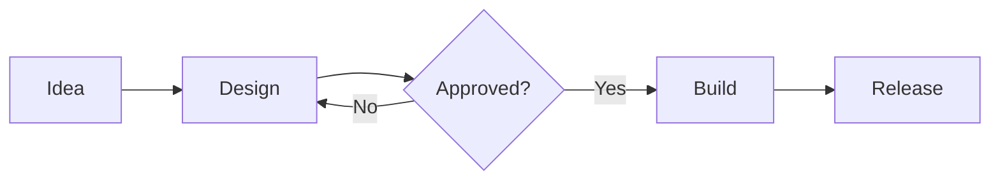

# Weekly product notes

Quick summary of the week: the **new onboarding flow** shipped on Tuesday, and early numbers look *encouraging*. Details below.

Next week we will focus on pricing and the mobile app.

## Tasks

- [x] Ship onboarding flow
- [x] Fix the export bug
- [ ] Write the release notes
- [ ] Review the pricing page copy

## Metrics

| Metric | Last week | This week |
|---|---|---|
| Sign-ups | 412 | 538 |
| Activation | 31% | 38% |
| Support tickets | 57 | 44 |

## Weekly report script

```python
from collections import Counter

def top_events(events, n=3):
    counts = Counter(e["name"] for e in events)
    return counts.most_common(n)

print(top_events([{"name": "signup"}, {"name": "export"}, {"name": "signup"}]))
```

## Release flow


