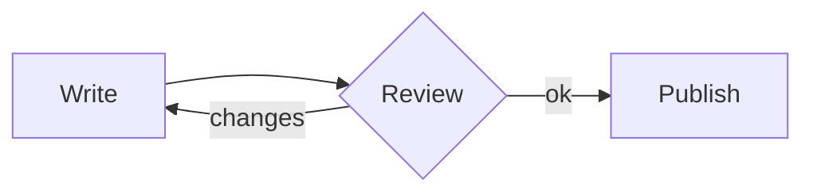

# Heading one

## Heading two

### Heading three

A paragraph with **bold**, *italic*, ~~strike~~, `inline code` and a [link to the docs](https://example.com/docs) in it.

- First bullet
- Second bullet
  - Nested bullet

1. First step
2. Second step

- [ ] An open task
- [x] A finished task

> A quote that sits in the margin
> and continues here.

---

```python
def greet(name):
    # say hello
    return "Hello, " + name
```

| Name | Value |
|------|:-----:|
| alpha | 1 |
| beta | 2 |


A sentence with a <span style="color:#d73a49">red word</span> and a <mark style="background:rgba(255,212,0,0.35)">highlighted phrase</mark> in it.



The end.
